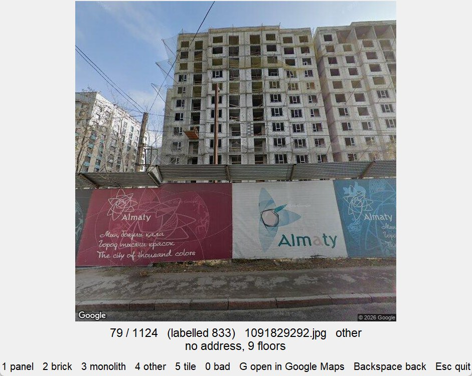
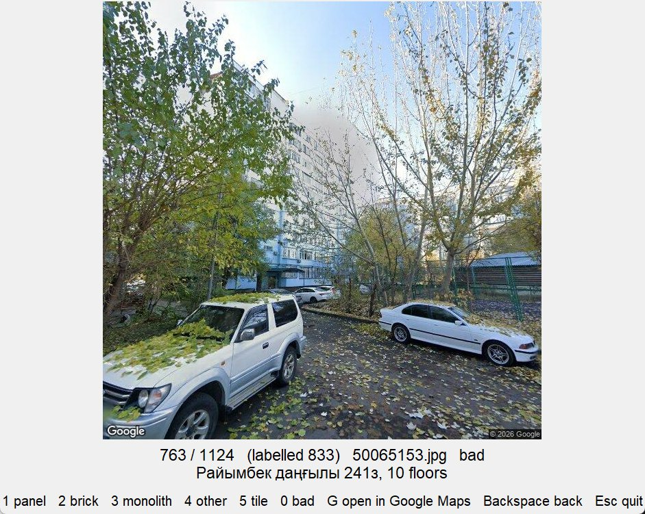
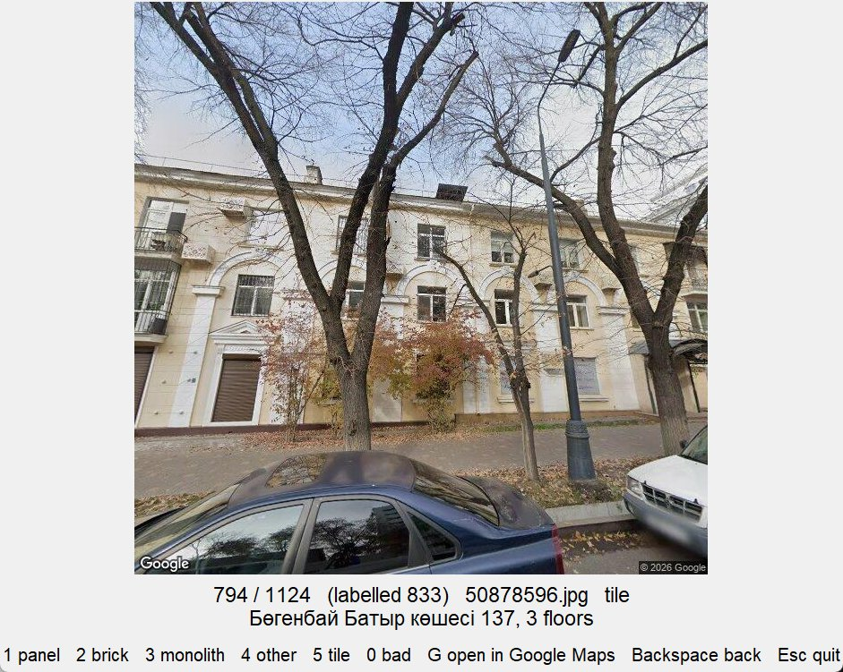
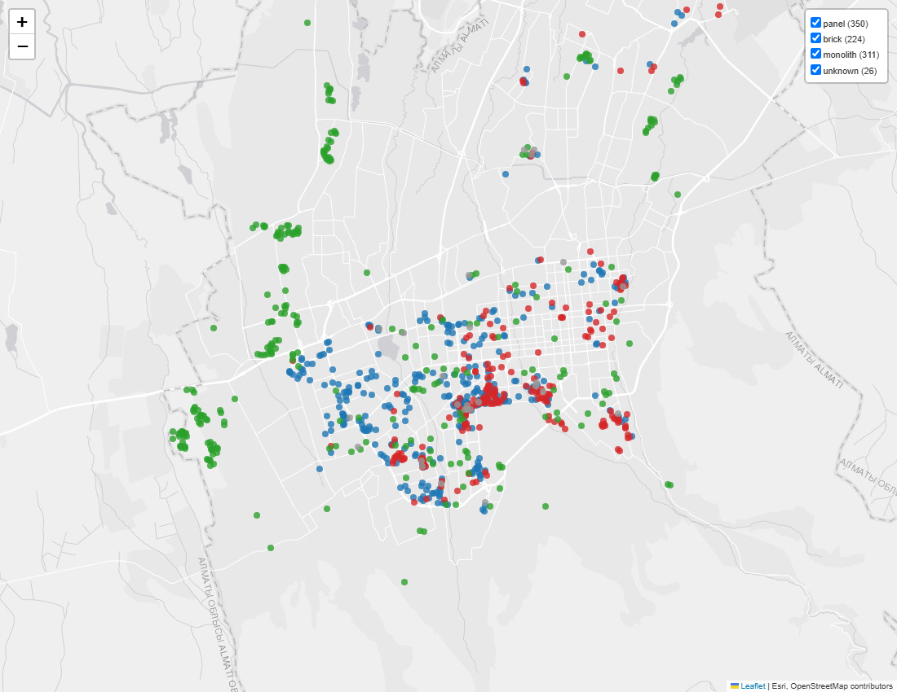

# Almaty Buildings

Most apartment blocks in Almaty were built in the USSR, and the USSR mostly built the same standard types of houses again and again. History showed that not all of these types are safe for an earthquake like Almaty can have. The project finds out the type of each building, to see which ones may be at risk.

There are about 9,000 apartment blocks in Almaty: JICA counted about 8,800 around 2008, and [Nazarbayev University (Rashid et al., 2023)](https://www.mdpi.com/2075-5309/13/4/1053) studied 8,171 Soviet-era buildings. I took about 7,000 from OpenStreetMap and downloaded Street View photos for around 1,100. About 830 I labelled by hand and used them for supervised learning.

While labelling I noticed that houses often look not like what they really are. Old houses look new after facade repair, and new houses that nobody looks after start to look old. Also I found that brick houses with bare brick almost don't exist anymore. Brick buildings are usually covered with square plates around one metre by one metre, or with other decoration.

I labelled the photos in a small window I made for this (`src/label.py`), one key per class. Some examples of problems:

The house is still being built, so it is not clear yet what it is. Such houses I marked as "other" and didn't use.

Trees in front of the house, it can't be seen. Bad photo.

Old house, but the walls are under plaster and decoration. For such houses I used "tile", and in training they count as brick.

After labelling I wanted to check how good today's LLMs are at telling the building type. In my test Codex (OpenAI) was right on 90% of photos, and on 93% if we don't count a few small problems with the photos.

## Model

I took ResNet-50, which was already trained on about a million ordinary photos (ImageNet), and changed its last layer so it gives the three classes I need: panel, brick and monolith. Then I trained it more on my 464 labelled photos. The model gives the answer in percent, so we also see how sure it is. The main plus of the model is that it is fast and runs on my own laptop for free, so it can label the whole city.

Later I also tried CLIP with logistic regression. It was better on test, so the map below is made with CLIP.

## How I tested it

I split the photos by district. Districts in Almaty were not built all at once, but at different times, so one district often has its own type of houses.

| Part | Districts | Photos |
|---|---|---|
| train | Bostandyk, Auezov, Alatau, Nauryzbay, Turksib | 464 |
| validation | Medeu | 53 |
| test | Almaly, Jetisu | 103 |

## Results

| Model | Accuracy on test |
|---|---|
| ResNet-50 | 72.8% |
| CLIP | 78.6% |
| Codex | 93.2% |

The model's answers for 911 buildings. Brick (red) is mostly in the old center, monolith (green) is mostly on the edges of the city. The interactive map is in `results/map_predictions.html`.

## Limitations

- Many buildings that look like panel houses are actually monolith, and the other way round. The district has to be taken into account.
- Some old houses were strongly renovated. This didn't really stop me from telling if a house is monolith or not, but it made it harder to tell the exact type.
- Brick houses from the 1950s-60s are usually worse than the ones from the 1970s-80s, but adding this to the classes is quite hard.
- The number of floors is not taken into account. For example, a 2-storey Stalin-era house can be at risk, but it can still be safer than an 11-storey panel house, at least because during an earthquake it takes longer to get down from the 11th floor.

## Data source

Photos are from the Google Street View Static API. The photos are not in this repo, only the code and building coordinates (and 3 screenshots of the labelling window as examples). Buildings are from OpenStreetMap (© OpenStreetMap contributors).
