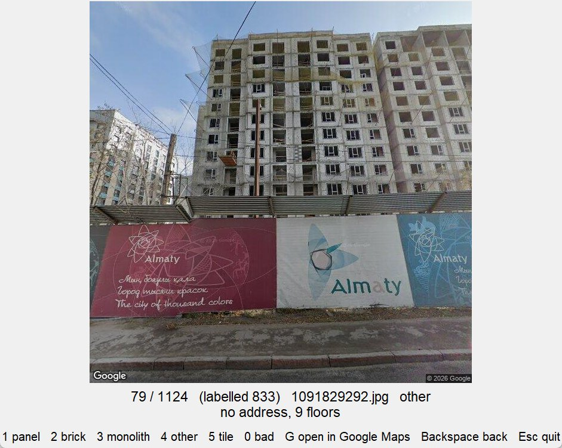
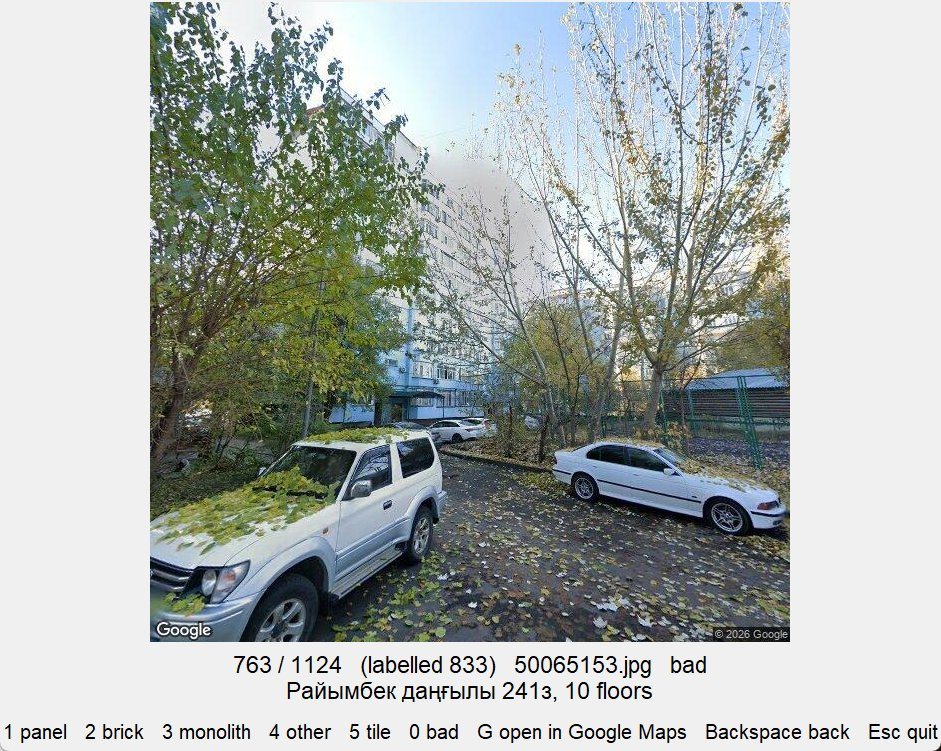
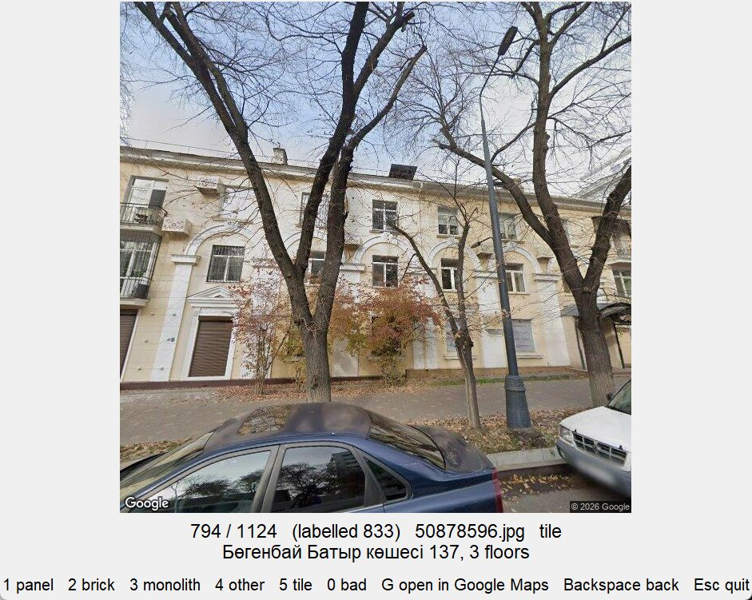
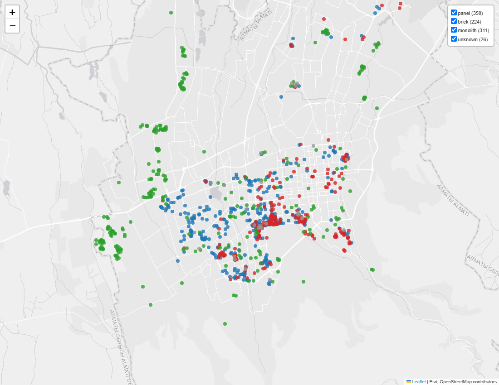

# Almaty Buildings

Most apartment blocks in Almaty were built in the USSR, and the USSR mostly built the same standard types of houses again and again. History showed that not all of these types are safe for the kind of earthquake Almaty can have. The project finds out the type of each building, to see which ones may be at risk.

There are about 9,000 apartment blocks in Almaty: JICA counted about 8,800 around 2008, and [Nazarbayev University (Rashid et al., 2023)](https://www.mdpi.com/2075-5309/13/4/1053) studied 8,171 Soviet-era buildings. I took about 7,000 from OpenStreetMap and downloaded Street View photos for around 1,100. About 830 I labelled by hand and used them for supervised learning. About 210 of them were bad photos or "other", so 620 were left for training and testing.

While labelling I noticed that houses often don't look like what they really are. Old houses look new after facade repair, and new houses that nobody looks after start to look old. Also I found that brick houses with bare brick almost don't exist anymore. Brick buildings are usually covered with square plates around one metre by one metre, or with other decoration.

I labelled the photos in a small window I made for this (`src/label.py`), one key per class. Some examples of problems:



The house is still being built, so it is not clear yet what it is. Such houses I marked as "other" and didn't use.



Trees in front of the house, so it can't be seen. Bad photo.



Old house, but the walls are under plaster and decoration. For such houses I used "tile", and in training they count as brick.

After labelling I wanted to check how good today's LLMs are at telling the building type. In my test Codex (OpenAI) was right on 90% of photos, and on 93% if we don't count a few small problems with the photos.

## Model

I took ResNet-50, which was already trained on about a million ordinary photos (ImageNet), and changed its last layer so it gives the three classes I need: panel, brick and monolith. Then I trained it more on my 464 labelled photos. The model gives the answer in percent, so we also see how sure it is. The main plus of the model is that it is fast and runs on my own laptop for free, so it can label the whole city.

Later I also tried CLIP with logistic regression. In cross-validation by district it got 79%, better than ResNet, so the map below is made with CLIP.

## How I tested it

I split the photos by district. Districts in Almaty were not built all at once, but at different times, so one district often has its own type of houses.

| Part | Districts | Photos |
|---|---|---|
| train | Bostandyk, Auezov, Alatau, Nauryzbay, Turksib | 464 |
| validation | Medeu | 53 |
| test | Almaly, Jetisu | 103 |

## Results

| Model | Accuracy on test |
|---|---|
| ResNet-50 | 72.8% |
| CLIP | 78.6% |
| Codex | 93.2% |

The test has only 103 photos, so every number has a wide margin: about 64-81% for ResNet, 70-86% for CLIP and 87-97% for Codex (95% intervals). The difference between ResNet and CLIP is 6 photos and could be luck. A model that always says "panel" would get 43%. Codex got my labelling rules, and my labels follow the same rules, so the test was easier for it.



The model's answers for 911 buildings (grey = the model is not sure). Brick (red) is mostly in the old center, monolith (green) is mostly on the edges of the city. The interactive map is in `results/map_predictions.html`.

### By district

How many houses of each type are in every district (`src/district_stats.py`). Where I labelled the house by hand I used my label, for the rest the model. Bad photos and "other" are not counted.

| District | Buildings | Panel | Brick | Monolith |
|---|---|---|---|---|
| Medeu | 95 | 31% | 52% | 18% |
| Bostandyk | 296 | 51% | 35% | 14% |
| Almaly | 81 | 56% | 24% | 21% |
| Jetisu | 39 | 21% | 23% | 56% |
| Auezov | 160 | 68% | 19% | 13% |
| Turksib | 62 | 19% | 18% | 63% |
| Alatau | 92 | 0% | 0% | 100% |
| Nauryzbay | 66 | 0% | 0% | 100% |

Alatau and Nauryzbay are only monolith, because they were mostly built after 2000. Most of the brick houses are in Medeu and Bostandyk.

### By number of floors

Floors are taken from OSM, 723 of 891 buildings have them (`src/floors.py`).

| Floors | Buildings | Panel | Brick | Monolith |
|---|---|---|---|---|
| 1-3 | 58 | 28% | 72% | 0% |
| 4-5 | 426 | 51% | 34% | 14% |
| 6-9 | 131 | 36% | 1% | 63% |
| 10-12 | 74 | 5% | 3% | 92% |
| 13+ | 34 | 6% | 0% | 94% |

Brick is almost only up to 5 floors. Most houses higher than 9 floors are monolith, so the risk of tall panel houses concerns a smaller number of buildings than I expected.

### What the models mix up

Rows are the real type, columns are the answer (`src/confusion.py`, test photos only).

| CLIP | panel | brick | monolith |
|---|---|---|---|
| **panel** | 34 | 8 | 2 |
| **brick** | 6 | 17 | 0 |
| **monolith** | 3 | 3 | 30 |

Most mistakes are between panel and brick, 14 of 22. Monolith is easier, the model almost never calls it brick.

## Limitations

- Many buildings that look like panel houses are actually monolith, and the other way round. The district has to be taken into account.
- Some old houses were strongly renovated. This didn't really stop me from telling if a house is monolith or not, but it made it harder to tell the exact type.
- Brick houses from the 1950s-60s are usually worse than the ones from the 1970s-80s, but adding this to the classes is quite hard.
- The number of floors is not used by the model, it is only counted after (see above). For example, a 2-storey Stalin-era house can be at risk, but it can still be safer than an 11-storey panel house, at least because during an earthquake it takes longer to get down from the 11th floor.
- All labels are mine and nobody checked them. In the "brick" class only 24 photos show real brick. The other 92 are houses under facing tiles, where I assumed brick. I still need to check a sample against real estate listings.
- The confidence of the model is too high. On the test photos with 60-80% confidence it was right only 4 times out of 11.
- The map has 911 buildings, about 13% of the apartment blocks in OpenStreetMap, and only those with a Street View photo close enough. So the tables by district are a first picture, not statistics for the city.

## Data source

Photos are from the Google Street View Static API. The photos are not in this repo, only the code and building coordinates (and 3 screenshots of the labelling window as examples). Buildings are from OpenStreetMap (© OpenStreetMap contributors).

## How to run

Put your Google Maps key in `.env` (see `.env.example`), then:

```
pip install -r requirements.txt
python src/download_buildings.py     # buildings from OpenStreetMap
python src/add_districts.py          # district of every building
python src/download_photos.py 10     # Street View photos
python src/label.py                  # label photos by hand (rules in LABELING.md)
python src/clip_logreg.py            # cross-validation
python src/predict_city.py           # label every photo
python src/make_map.py --pred        # map of the city
python src/district_stats.py         # types by district
python src/floors.py                 # types by number of floors
python src/confusion.py              # what the models mix up
```
